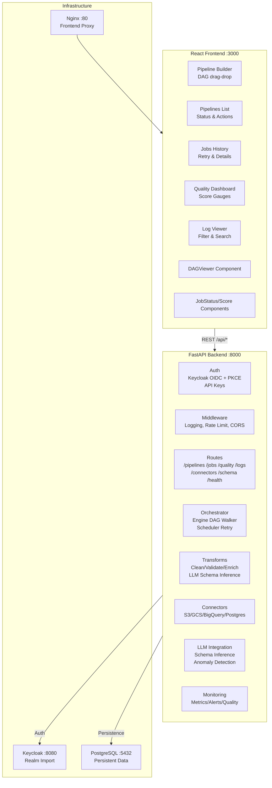

# AI Data Pipeline Orchestrator — Alan Vo | AI & Machine Learning

> Work in progress. This checkpoint may be incomplete or fail tests. See PLAN.md and STATUS.md before use.


**Problem**: Data engineers building AI/ML pipelines spend excessive time on boilerplate orchestration, schema discovery, and quality validation instead of model development. Existing tools either lack visual DAG authoring, require proprietary platforms, or treat LLM-assisted schema inference as an afterthought.

**Solution**: A self-hosted, open-source pipeline orchestrator with a visual drag-and-drop DAG builder, LLM-powered schema inference and anomaly detection (with offline fallbacks), multi-dimensional data quality scoring, and multi-cloud connectors — all deployable via Docker Compose with Keycloak SSO.

**Intended User**: Data engineers and ML engineers who need a reproducible, auditable pipeline platform for AI/ML data preparation workflows, with the flexibility to run on any infrastructure.

## Architecture



## Quick Start

```bash
git clone https://github.com/ALANDVO/ai-data-pipeline-alan-vo.git
cd ai-data-pipeline-alan-vo
cp .env.example .env
# Edit .env with your credentials (JWT_SECRET, LLM_API_KEY, etc.)
docker compose up -d
# Frontend: http://localhost:3000
# Backend API: http://localhost:8000
# Keycloak Admin: http://localhost:8080 (admin / KEYCLOAK_ADMIN_PASSWORD)
```

## API Reference

| Method | Endpoint | Description | Auth |
|--------|----------|-------------|------|
| `POST` | `/api/auth/login` | Initiate Keycloak OIDC login (redirect) | — |
| `GET` | `/api/auth/callback` | OIDC callback, exchange code for JWT | — |
| `GET` | `/api/auth/me` | Get current user from JWT | Bearer / API Key |
| `POST` | `/api/auth/api-keys` | Create API key | Bearer |
| `GET` | `/api/auth/api-keys` | List API keys | Bearer |
| `GET` | `/api/health` | Health check | — |
| `GET` | `/api/pipelines` | List pipelines (filter: `?status=active`) | Bearer / API Key |
| `POST` | `/api/pipelines` | Create pipeline (DAG nodes/edges) | Bearer / API Key |
| `GET` | `/api/pipelines/{id}` | Get pipeline details | Bearer / API Key |
| `POST` | `/api/pipelines/{id}/validate` | Validate DAG (topological sort, cycles) | Bearer / API Key |
| `POST` | `/api/pipelines/{id}/run` | Trigger pipeline execution | Bearer / API Key |
| `GET` | `/api/jobs` | Job execution history (filter: `?status=failed&pipeline_id=...`) | Bearer / API Key |
| `GET` | `/api/jobs/{id}` | Job status, task results, durations | Bearer / API Key |
| `POST` | `/api/jobs/{id}/retry` | Retry failed job | Bearer / API Key |
| `GET` | `/api/quality` | Data quality scores (filter: `?pipeline_id=...`) | Bearer / API Key |
| `GET` | `/api/logs` | Pipeline log stream (filter: `?job_id=...&level=error`) | Bearer / API Key |
| `POST` | `/api/schema/infer` | LLM-powered schema inference from sample rows | Bearer / API Key |
| `GET` | `/api/connectors` | List configured connectors with health | Bearer / API Key |
| `POST` | `/api/anomaly/detect` | Anomaly detection on sample rows | Bearer / API Key |

## AI/ML Evaluation

The LLM-powered features (schema inference, anomaly detection) are evaluated against a deterministic local fallback:

| Task | LLM Provider | Local Fallback | Confidence (LLM) | Confidence (Local) |
|------|--------------|----------------|------------------|---------------------|
| Schema Inference | OpenAI/Gemini/Anthropic/Ollama | Type sampling from first 100 rows | 0.85–0.95 | 0.60 |
| Anomaly Detection | OpenAI/Gemini/Anthropic/Ollama | Statistical outlier (z-score > 3) + null/expectation checks | 0.75–0.90 | 0.70 |

**Reproducible Evaluation**:
```bash
# Run local fallback only (no LLM key required)
python -c "
from backend.app.services.transforms.llm import pipeline_llm
import asyncio
rows = [{'id': i, 'value': float(i)*1.5, 'label': 'A' if i%2==0 else 'B'} for i in range(100)]
rows[50]['value'] = 9999  # injected anomaly
result = asyncio.run(pipeline_llm.detect_anomalies(rows))
print('Anomalies:', len(result['anomalies']), 'Summary:', result['summary'])
"
```

**Data Provenance**: Synthetic test data generated in CI; no external datasets used.

**Failure Cases**:
- LLM returns malformed JSON → caught by `_parse_json`, falls back to local
- LLM timeout (60s) → falls back to local
- Empty sample rows → returns empty schema with confidence 0.0
- Very wide tables (>50 columns) → truncated to first 3000 chars for prompt

## Security Limitations

- **JWT Secret**: Must be rotated in production; default `change-me-in-production` refuses to start in demo mode if unchanged
- **Keycloak**: Development realm uses pre-seeded users; production must use external IdP via SAML/OIDC broker
- **API Keys**: Stored as SHA-256 hashes; no plaintext recovery
- **Rate Limiting**: In-memory per-IP (60 req/min); not distributed — add Redis for multi-instance
- **CORS**: Configured for `*` in development; restrict to known origins in production
- **Secrets**: Never committed; all via `.env` or Docker secrets
- **TLS**: Required in production; terminate at reverse proxy (nginx/Traefik) — see `docs/deployment.md`

## Provider Configuration

| Provider | `LLM_BASE_URL` | `LLM_MODEL` Examples | Auth Header | Notes |
|----------|----------------|----------------------|-------------|-------|
| OpenAI | `https://api.openai.com/v1` | `gpt-4o`, `gpt-4o-mini` | `Bearer $LLM_API_KEY` | Default |
| Anthropic | `https://api.anthropic.com/v1` | `claude-3-5-sonnet-20241022` | `x-api-key: $LLM_API_KEY` | Uses `/messages` endpoint |
| Gemini | `https://generativelanguage.googleapis.com/v1beta` | `gemini-1.5-pro` | `key=$LLM_API_KEY` (query) | Uses `generateContent` |
| Ollama | `http://localhost:11434/v1` | `llama3.1:8b`, `mistral:7b` | None (local) | OpenAI-compatible API |
| LiteLLM | `http://litellm:4000/v1` | Any proxied model | `Bearer $LLM_API_KEY` | Multi-model gateway |
| OpenRouter | `https://openrouter.ai/api/v1` | `openrouter/auto` | `Bearer $LLM_API_KEY` | Model routing |

Set `LLM_PROVIDER` to `openai`, `anthropic`, `gemini`, `ollama`, `litellm`, or `openrouter` to select adapter. Default: `openai`.

## SSO/SAML Setup (Keycloak)

### OIDC (Keycloak Native)
1. Start stack: `docker compose up -d keycloak`
2. Access Keycloak Admin: `http://localhost:8080` (user: `admin`, password: `KEYCLOAK_ADMIN_PASSWORD`)
3. Realm `pipeline-realm` is pre-imported with client `pipeline-frontend`
4. Configure redirect URIs in client settings for your domain
5. Set `.env`: `OAUTH_CLIENT_ID=pipeline-frontend`, `OAUTH_CLIENT_SECRET=<from Keycloak>`, `OAUTH_REDIRECT_URI=https://yourdomain.com/api/auth/callback`

### SAML via Identity Brokering
Keycloak supports upstream SAML IdPs (Okta, Azure AD, PingFederate) through Identity Brokering:
1. In Keycloak Admin → Identity Providers → Add SAML v2.0
2. Configure IdP metadata URL or upload XML
3. Map SAML attributes to Keycloak user attributes (email, firstName, lastName)
4. Enable "First Login Flow" to link or create local accounts
5. Users click "Sign in with SAML" on the login page

**No native SAML implementation** — Keycloak handles the protocol; this app only validates Keycloak-issued OIDC tokens.

## Local Development

```bash
# Backend
cd backend
python -m venv .venv
.venv/bin/pip install -r requirements.txt
.venv/bin/pip install pytest pytest-asyncio httpx
PYTHONPATH=../backend .venv/bin/python -m pytest tests/ -v
# Run server: .venv/bin/uvicorn backend.app.main:app --reload

# Frontend
cd frontend
npm install
npm run dev  # http://localhost:5173
npm run build  # typecheck + vite build
npm test  # vitest
```

## Testing

```bash
# Backend tests (12+ meaningful tests)
cd backend && PYTHONPATH=.. .venv/bin/python -m pytest tests/ -v

# Frontend tests (3+ component tests)
cd frontend && npm test -- --run

# CI runs both via .github/workflows/ci.yml
```

## Deployment Notes

- **Reverse Proxy**: Terminate TLS at nginx/Traefik/Caddy; forward to `backend:8000` and `frontend:80`
- **Backup/Restore**: `pg_dump`/`pg_restore` for PostgreSQL; Keycloak realm export via Admin Console
- **IdP Enrollment**: Document your SAML/OIDC IdP metadata; test with Keycloak broker before go-live
- **Scaling**: Backend is stateless (except in-memory rate limit); add Redis for distributed rate limiting
- **Monitoring**: `/api/health` for liveness; Prometheus metrics endpoint planned

## License

MIT — see [LICENSE](LICENSE)

---

**Built by [Alan Vo](https://github.com/ALANDVO)** | alanvo@gmail.com | AI, ML & Data Engineering